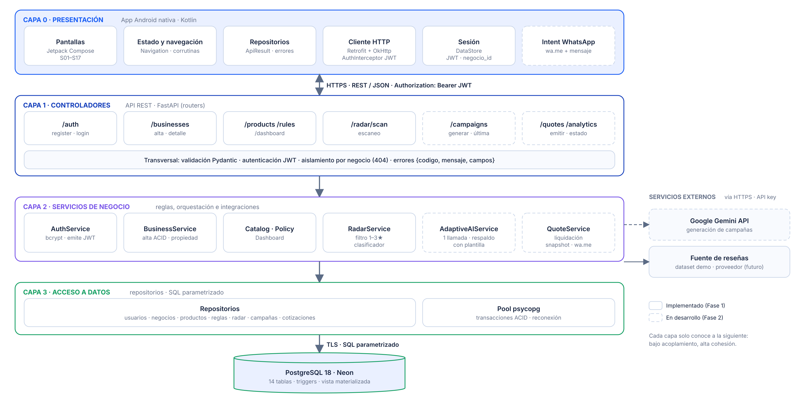
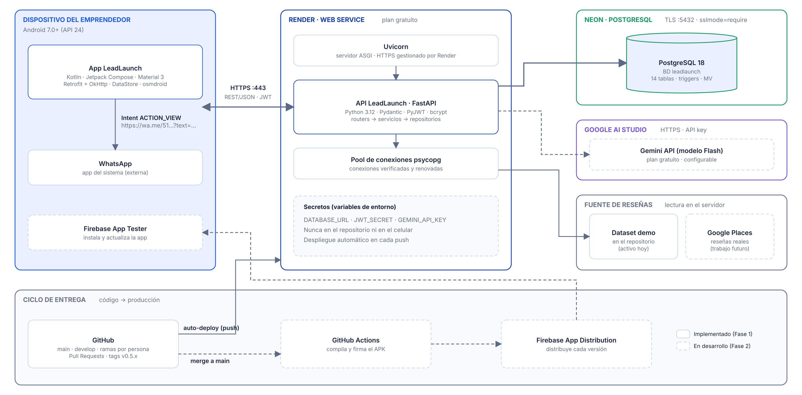
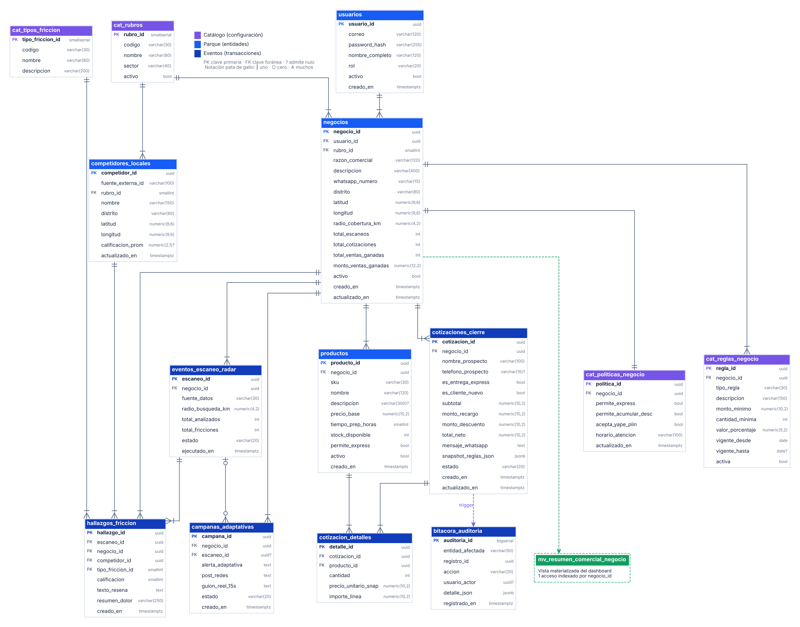
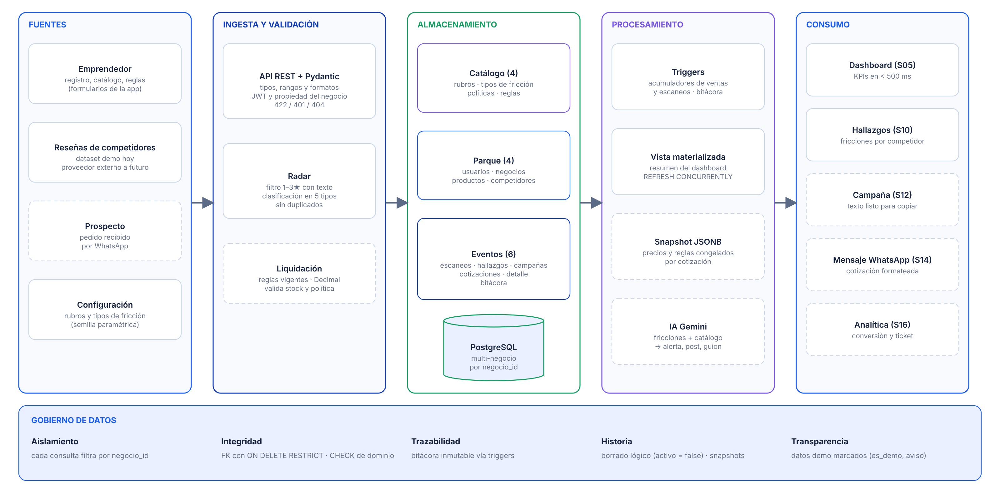

# LeadLaunch

**Radar comercial y copiloto de ventas para emprendimientos locales de repostería y comida.**

LeadLaunch analiza las quejas de los competidores cercanos, convierte esas quejas en campañas listas para publicar y genera cotizaciones exactas que se envían por WhatsApp en un toque.

| Componente | Tecnología | Estado |
|---|---|---|
| App móvil | Android nativo · Kotlin · Jetpack Compose | Fase 1 en producción |
| API REST | Python · FastAPI | Desplegada en Render |
| Base de datos | PostgreSQL 18 | Neon (nube) |

**Versión actual:** `v0.5.1` (Fase 1 cerrada) · **API:** `https://leadlaunch-api.onrender.com/api/v1` · **Swagger:** [`/docs`](https://leadlaunch-api.onrender.com/docs)

---

## 1. El problema

Un emprendimiento pequeño de repostería compite en un radio de pocos kilómetros con negocios ya conocidos, sin presupuesto para publicidad pagada y vendiendo casi todo por WhatsApp. En la práctica:

- **No sabe qué le duele al cliente de la zona.** Las quejas existen (reseñas de 1 a 3 estrellas de la competencia), pero nadie las lee de forma sistemática.
- **No sabe qué comunicar.** Publica contenido genérico que no responde a ninguna necesidad concreta del mercado local.
- **Cotiza a mano.** Calcula recargos y descuentos en el chat, se equivoca, tarda y pierde la venta. No queda historial para medir qué se cierra.

## 2. La solución

LeadLaunch cierra el ciclo completo **detectar → comunicar → cotizar → medir**:

1. **Radar de fricciones.** Busca competidores dentro del radio del negocio, filtra solo las reseñas negativas con texto y las clasifica en 5 tipos de fricción (demora en la entrega, presentación o frescura, precio o envío alto, mala atención, sin opciones urgentes). No usa IA: es rápido, gratuito y reproducible.
2. **Campaña adaptativa con IA.** A partir de las fricciones y del catálogo, una sola llamada a Gemini devuelve una alerta de ajuste de oferta, un post para redes y un guion de reel de 15 s. Si la IA falla, se usa una plantilla.
3. **Cotización paramétrica.** El servidor aplica las reglas del negocio (recargo express, descuento de bienvenida o por volumen), guarda una copia inmutable de precios y reglas y arma el mensaje y el enlace de WhatsApp.
4. **Seguimiento.** Cada cotización avanza por estados (borrador, enviada, ganada, perdida); el dashboard muestra ventas ganadas y conversión.

### Caso de ejemplo

> **Ana abre Dulce Punto en Miraflores.**
>
> 1. **Configura su negocio** con un radio de 3 km y 4 productos: torta S/ 75, cheesecake S/ 65, cupcakes S/ 35 y postre S/ 12. *(app real)*
> 2. **Escanea su zona:** 4 competidores, 21 reseñas y 13 quejas. La más repetida es la demora en la entrega (4 de 13). *(app real)*
> 3. **Recibe una campaña** que destaca puntualidad y pedidos express, con post y guion. *(Fase 2)*
> 4. **Cotiza en un toque:** María pide 1 torta y 2 cheesecakes, express, cliente nueva.
>    S/ 205.00 + 15 % express (S/ 30.75) − 10 % bienvenida (S/ 20.50) = **S/ 215.25**, enviado por WhatsApp. *(Fase 2)*
> 5. **Mide el cierre:** María confirma, la cotización pasa a GANADA y el dashboard suma S/ 215.25. *(Fase 2)*

## 3. Alcance

| Módulo | Qué incluye | Pantallas | API | Historia | Estado |
|---|---|---|---|---|---|
| Cuenta y negocio | Registro, login JWT, alta del negocio con ubicación y radio | S01–S04 | `auth` · `businesses` | HU-01 | ✅ Listo |
| Catálogo | Productos con SKU único, precio, stock, horas de preparación y opción express | S06–S07 | `products` | HU-01 | ✅ Listo |
| Reglas comerciales | Recargo express, descuentos de bienvenida y volumen, medios de pago | S08 | `rules` | HU-02 | ✅ Listo |
| Radar de fricciones | Competidores en el radio, filtro de 1 a 3 ★, 5 tipos de fricción | S09–S10 | `radar/scan` | HU-03 | ✅ Listo |
| Dashboard | Productos, fricciones, cotizaciones, ventas ganadas y conversión | S05 | `dashboard` | HU-06 | ✅ Listo |
| Campañas con IA | Alerta de oferta, post y guion de 15 s en una sola llamada | S11–S12 | `campaigns` | HU-04 | 🔧 Fase 2 |
| Cotizaciones | Liquidación con reglas, snapshot, mensaje y enlace de WhatsApp | S13–S14 | `quotes` | HU-05 | 🔧 Fase 2 |
| Seguimiento | Estados, historial y analítica de conversión | S15–S17 | `quotes` · `analytics` | HU-06 | 🔧 Fase 2 |

**Totales:** 17 pantallas · 17 endpoints (11 del diseño original y 6 agregados para consultar datos) · 14 tablas · 6 historias de usuario (47 puntos).

**Fuera del alcance del MVP:** reseñas reales de un proveedor externo (hoy el radar usa un conjunto de datos de demostración y lo indica en la app), publicación directa en redes, recordatorios automáticos y rubros distintos de gastronomía.

## 4. Arquitectura orientada a servicios



La app no accede a la base de datos: consume una API REST propia, protegida con JWT, organizada en cuatro capas.

| Capa | Responsabilidad | Implementación |
|---|---|---|
| 0 · Presentación | Pantallas, navegación, sesión y llamadas HTTP | Kotlin · Compose · Retrofit · DataStore |
| 1 · Controladores | Rutas, validación de entrada, autenticación, aislamiento por negocio y formato de error único | FastAPI routers · Pydantic |
| 2 · Servicios | Reglas de negocio: radar, liquidación de cotizaciones, IA | Servicios por dominio |
| 3 · Acceso a datos | SQL parametrizado y transacciones | Repositorios · pool `psycopg` |

**Por qué esta arquitectura:**

- **Seguridad.** Las claves (base de datos, Gemini) y las reglas de precios viven solo en el servidor. Una app con SQLite local o con acceso directo a la base expondría credenciales y permitiría alterar precios desde el celular.
- **Una sola fuente de verdad.** El cálculo de una cotización ocurre en un único lugar y queda auditado; la app solo muestra el resultado.
- **Capas independientes.** Cada capa se prueba y se cambia por separado: la app puede usar datos simulados mientras la API evoluciona, y el radar puede cambiar de fuente de reseñas sin tocar la app.
- **Proporcional al tamaño del proyecto.** Se descartaron los microservicios: añadirían despliegues, red y consistencia distribuida sin beneficio real para un MVP de un solo dominio. Un monolito modular por servicios se puede dividir más adelante si hace falta.

**Convenciones de la API:** prefijo `/api/v1`, `Authorization: Bearer <token>` (24 h), un negocio por cuenta, un negocio ajeno responde `404` (no revela que existe) y todo error tiene la forma `{"error": {"codigo", "mensaje", "campos"}}`.

## 5. Arquitectura tecnológica



| Pieza | Tecnología | Por qué |
|---|---|---|
| App | Android nativo, Kotlin, Jetpack Compose, Retrofit + OkHttp | Rendimiento nativo y acceso directo a WhatsApp por *Intent* |
| API | FastAPI + Uvicorn, Pydantic, PyJWT, bcrypt | Validación tipada, documentación Swagger automática, asincronía |
| Base de datos | PostgreSQL 18 en Neon (TLS, `sslmode=require`) | Triggers, JSONB y vistas materializadas; plan gratuito administrado |
| Hosting | Render (despliegue automático desde GitHub) | Cada merge publica la API sin pasos manuales |
| IA | Google Gemini (AI Studio, por HTTPS con API key) | Texto en español con salida estructurada; plan gratuito |
| Distribución | Firebase App Distribution + GitHub Actions *(planificado)* | Instalación y actualización de la app para el equipo y el jurado |

## 6. Datos

### 6.1 Modelo entidad-relación



14 tablas en tres grupos. Todo cuelga de `negocios`, por eso cada consulta se filtra por `negocio_id`.

| Grupo | Tablas | Rol |
|---|---|---|
| Catálogo | `cat_rubros`, `cat_tipos_friccion`, `cat_politicas_negocio`, `cat_reglas_negocio` | Parámetros configurables sin cambiar código |
| Parque | `usuarios`, `negocios`, `productos`, `competidores_locales` | Entidades estables del negocio |
| Eventos | `eventos_escaneo_radar`, `hallazgos_friccion`, `campanas_adaptativas`, `cotizaciones_cierre`, `cotizacion_detalles`, `bitacora_auditoria` | Transacciones e historia |

Más la vista materializada `mv_resumen_comercial_negocio`, que alimenta el dashboard. Una vista resumida está en [`er_resumen.png`](docs/arquitectura/er_resumen.png).

### 6.2 Diseño físico de la base de datos

| Decisión | Implementación en PostgreSQL | Beneficio |
|---|---|---|
| Catálogo / parque / eventos | 4 + 4 + 6 tablas normalizadas | Reglas configurables sin tocar código |
| Claves | UUID con `gen_random_uuid()` | Identificadores no adivinables |
| Integridad | FK con `ON DELETE RESTRICT`, `CHECK`, borrado lógico | Ningún borrado en cascada accidental |
| Índices | 8 compuestos `(negocio_id, fecha DESC)` | Consultas por negocio ya ordenadas |
| FILLFACTOR | 80 en tablas que se actualizan, 100 en solo inserción | Menos fragmentación de páginas |
| Triggers | Acumuladores de ventas y escaneos, bitácora | Contadores siempre consistentes |
| Vista materializada | Índice único + `REFRESH CONCURRENTLY` | Dashboard en un solo acceso |
| Snapshot JSONB | Precios y reglas congelados por cotización | La historia no cambia si cambia el catálogo |

El script completo está en [`database/01_ddl.sql`](database/01_ddl.sql) y los datos iniciales en [`database/02_seed.sql`](database/02_seed.sql).

### 6.3 Parque de datos

Cada macroevento del negocio escribe en tablas concretas mediante métodos con SQL parametrizado.

| Macrofunción | Macroevento | Operación de negocio | Métodos | Atributos clave |
|---|---|---|---|---|
| Definición | `REGISTRO_NEGOCIO` | Alta del emprendimiento y sus parámetros | `crear_negocio` · `crear_politica_base` · `asignar_reglas_base` | `negocio_id`, `rubro_id`, `latitud`, `longitud`, `radio_cobertura_km`, `whatsapp_numero` |
| Definición | `GESTION_CATALOGO` | Alta o cambio de producto | `upsert_producto` · `registrar_auditoria` | `sku`, `precio_base`, `tiempo_prep_horas`, `stock_disponible`, `permite_express` |
| Ingesta | `ESCANEO_RADAR` | Extracción y filtrado de fricciones | `crear_escaneo` · `upsert_competidor` · `insertar_hallazgo` | `fuente_datos`, `calificacion`, `texto_resena`, `tipo_friccion_id`, `resumen_dolor` |
| Atracción | `GENERACION_CAMPANA` | Síntesis de oferta y textos | `consultar_hallazgos` · `consultar_catalogo` · `guardar_campana` | `alerta_adaptativa`, `post_redes`, `guion_reel_15s`, `estado` |
| Venta | `EMISION_COTIZACION` | Liquidación paramétrica del pedido | `evaluar_politicas_reglas` · `crear_cotizacion` | `subtotal`, `monto_recargo`, `monto_descuento`, `total_neto`, `snapshot_reglas_json` |
| Cierre | `ACTUALIZACION_CIERRE` | Cambio de estado del prospecto | `actualizar_estado` · `acumular_ventas_ganadas` · `registrar_auditoria` | `estado`, `total_ventas_ganadas`, `monto_ventas_ganadas` |

Los tres primeros eventos están implementados; los tres últimos corresponden a la Fase 2.

### 6.4 Arquitectura de datos



Los datos siguen el recorrido **fuentes → ingesta y validación → almacenamiento → procesamiento → consumo**, con cinco reglas de gobierno:

- **Aislamiento:** toda consulta filtra por `negocio_id`.
- **Integridad:** claves foráneas restrictivas y restricciones `CHECK` de dominio.
- **Trazabilidad:** bitácora inmutable alimentada por triggers.
- **Historia:** borrado lógico y snapshots en las cotizaciones.
- **Transparencia:** los datos de demostración se marcan (`es_demo`) y la app lo avisa.

## 7. API

| Método y ruta | Uso | Estado |
|---|---|---|
| `POST /auth/register` · `POST /auth/login` | Cuenta y sesión | ✅ |
| `POST /businesses` · `GET /businesses/{id}` | Alta y consulta del negocio | ✅ |
| `GET /businesses/{id}/dashboard` | Resumen comercial | ✅ |
| `POST` · `GET /businesses/{id}/products` | Catálogo | ✅ |
| `GET` · `PUT /businesses/{id}/rules` | Políticas y reglas | ✅ |
| `POST /businesses/{id}/radar/scan` | Escaneo de la competencia | ✅ |
| `POST /businesses/{id}/campaigns/generate` · `GET …/campaigns/latest` | Campañas con IA | 🔧 |
| `POST /businesses/{id}/quotes` · `GET …/quotes` · `GET /quotes/{id}` | Cotizaciones e historial | 🔧 |
| `PATCH /quotes/{id}/status` | Cambio de estado | 🔧 |
| `GET /businesses/{id}/analytics` | Analítica de conversión | 🔧 |

Además, `GET /health` y `GET /health/db` para monitoreo. Detalle de cada contrato en [`docs/api/CONTRATOS_API.md`](docs/api/CONTRATOS_API.md).

> En el plan gratuito de Render el servidor se suspende tras 15 minutos sin uso; la primera llamada puede tardar unos 50 s.

## 8. Estructura del repositorio

```text
android/      App Android (Kotlin + Compose)
backend/      API REST FastAPI: routers, services, repositories, tests
database/     DDL, datos iniciales y dataset de demostración del radar
docs/
  api/            Contratos de la API
  arquitectura/   Diagramas (PNG) y sus fuentes
  diseno/         Maquetas de las 17 pantallas
  especificaciones/  Documento maestro y especificación UX/UI
  planificacion/  Plan general, planes por integrante y plan de la Fase 2
  presentacion/   Presentación del proyecto y capturas de la app
  pruebas/        Colección Postman, resultados y evidencias
render.yaml   Despliegue de la API en Render
```

## 9. Cómo ejecutarlo

**API (local):**

```powershell
cd backend
python -m venv .venv
.\.venv\Scripts\Activate.ps1
pip install -r requirements-dev.txt
copy .env.example .env      # completar DATABASE_URL y JWT_SECRET
uvicorn app.main:app --reload
```

Swagger en `http://127.0.0.1:8000/docs`. La base se crea con `database/01_ddl.sql` y `database/02_seed.sql` sobre una base vacía (nunca sobre la base de la demo).

**App:** abrir `android/` en Android Studio y ejecutar en un emulador o dispositivo (Android 7.0, API 24 o superior). Por defecto apunta a la API desplegada. Más detalle en [`android/README_ANDROID.md`](android/README_ANDROID.md) y [`backend/README.md`](backend/README.md).

## 10. Calidad

- **34 pruebas automáticas** (pytest) contra PostgreSQL: autenticación, negocio, catálogo, reglas, radar y reconexión a la base.
- **7 de 7 casos de QA** de la Fase 1 aprobados contra producción (colección Postman en `docs/pruebas/`).
- **100 % del esquema** desplegado coincide con el diseño.
- Hallazgos corregidos: intentos de inyección SQL contenidos por el firewall y por SQL parametrizado; reconexión automática a Neon tras inactividad.

## 11. Metodología

Scrum por checkpoints (CP0–CP6) con integración por Pull Requests.

```text
main      ← versiones estables con tag (v0.5.1 = Fase 1, v1.0.0 = cierre)
develop   ← integración en cada checkpoint
  ├── cesar/backend
  ├── giancarlos/android
  └── ernesto/db-qa
```

Nadie hace push directo a `main` ni a `develop`. Commits con el formato `tipo(HU-XX): descripción` (`feat`, `fix`, `docs`, `test`, `chore`).

## 12. Estado y hoja de ruta

| Fase | Contenido | Estado |
|---|---|---|
| Fase 1 · `v0.5.1` | Cuenta, negocio, catálogo, reglas, radar, dashboard y app conectada a la API | ✅ 26 de 47 puntos |
| Fase 2 · `v1.0.0` | Campañas con IA, cotizaciones, WhatsApp, historial, analítica y distribución de la app | 🔧 En desarrollo ([plan](docs/planificacion/04_PLAN_FASE2.md)) |
| Ideas futuras | Reseñas reales, publicación directa en redes, recordatorios a prospectos, otros rubros | 💡 |

## 13. Equipo · Grupo 2

| Integrante | Rol |
|---|---|
| Dionicio Achachagua, César Alonso | Líder · Backend y base de datos |
| Aguirre Alvarado, Giancarlo | App Android |
| Salazar Ramos, Ernesto Ramón | Pruebas y calidad |

Curso: Desarrollo Adaptativo e Integración de Sistemas.
